# rustmd

**Local-first, offline-capable notes for Markdown, HTML, CSV, TXT and JSON** — Windows, macOS (Apple Silicon) and Linux. A note is just a `.md` / `.html` / `.csv` / `.txt` / `.json` file in a folder: no import, no database, no sign-in. Edit HTML source and preview the fully rendered page in the app's **built-in WebView**, with no external browser.

<sub>**简体中文** · 本地优先、离线可用的 Markdown / HTML / CSV / TXT / JSON 笔记应用；HTML 源码编辑 + 内置 WebView 整页预览，无需外部浏览器。→ **[README.md](README.md)**</sub>

[](https://github.com/riverzhou/rustmd/actions/workflows/ci.yml)
[](https://github.com/riverzhou/rustmd/releases/latest)
[](https://github.com/riverzhou/rustmd/releases)
[](https://www.rust-lang.org/)
[](https://tauri.app/)
[](LICENSE)
[](https://github.com/riverzhou/rustmd/stargazers)

Current version **1.10.4** · GPL-3.0-or-later · [Changelog](CHANGELOG.md) · [Latest release](https://github.com/riverzhou/rustmd/releases/latest)

[](https://github.com/riverzhou/rustmd/releases/latest)
[](https://github.com/riverzhou/rustmd/releases/latest)
[](https://github.com/riverzhou/rustmd/releases/latest)

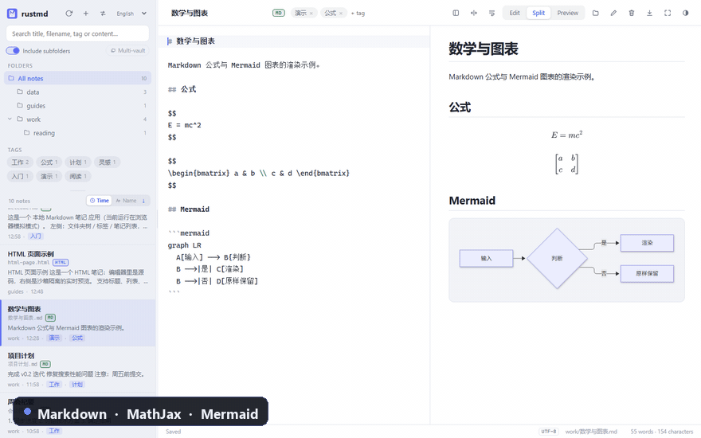

<sub>10-second tour: Markdown math & Mermaid → HTML notes rendered as full pages → CSV/TXT smart tables → JSON inspector → light and dark themes.</sub>

## Why rustmd

If you want a tool that keeps notes as **plain files** instead of locking them in a database:

- **HTML notes are first-class** — edit `.html` and see the full page on the right, rendered by the built-in WebView. Page styles, scripts, local images/CSS/JS and charts run natively; HTML/PNG/PDF exports keep the same layout. No Edge/Chrome, and no HTML stuffed into Markdown.
- **Five formats, one list** — Markdown (MathJax + Mermaid + syntax highlighting), HTML, CSV, TXT and JSON. CSV/TXT get smart column widths, right-aligned numbers and row bands; JSON gets a collapsible key/value inspector. Search covers titles, filenames, tags and body text.
- **Plain files** — notes are ordinary files in a folder you own; use Git, Syncthing, iCloud, OneDrive or any sync tool. No database, account or proprietary format.
- **Local-first + multi-vault** — editing, preview, search and export work offline; recent vaults, pinned vaults, a multi-vault view, current-folder scope and front-matter tags.
- **Lightweight and cross-platform** — Rust + Tauri 2, with a portable Windows zip, Linux deb/AppImage and a macOS Apple Silicon DMG. No Electron runtime.
- **Security-minded** — sanitized Markdown, HTML rendered in an isolated sandboxed iframe / hidden WebView, CSP, path containment, SSRF protection, and exports through the native save dialog.
- **Easy to migrate to** — open an existing Obsidian/Typora/VS Code folder; unknown Markdown front matter fields (`title:`, `date:`, …) are preserved on save; UTF-8/GBK/GB18030 decoding is automatic.

Good for personal knowledge bases, engineering notes, writing drafts, course notes, HTML reports and local documentation.

### How it compares

| Capability | rustmd | Obsidian | Typora | VS Code | Notepad++ |
| --- | --- | --- | --- | --- | --- |
| Open any folder, no import | ✅ | ✅ | ✅ | ✅ | ✅ |
| Full-page HTML note preview | ✅ built-in WebView | ❌ | ❌ | ⚠️ extension | ❌ |
| Native CSV / TXT / JSON views | ✅ | ❌ | ❌ | ⚠️ extension | ❌ |
| Markdown math / Mermaid | ✅ | ✅ | ✅ | ⚠️ extension | ❌ |
| Offline, no account | ✅ | ✅ | ✅ | ✅ | ✅ |
| Open source | ✅ GPL-3.0 | ❌ | ❌ | ✅ | ✅ |
| Price | Free | Free (sync/publish paid) | Paid | Free | Free |

> Based on public information as of November 2026; only dimensions relevant to this project are listed. All tools keep changing — check their official documentation.

## Screenshots

Folder tree, current-folder scope and multi-vault switches, filename cards, sort direction, **format badges for every supported type**, MathJax math and Mermaid diagrams:

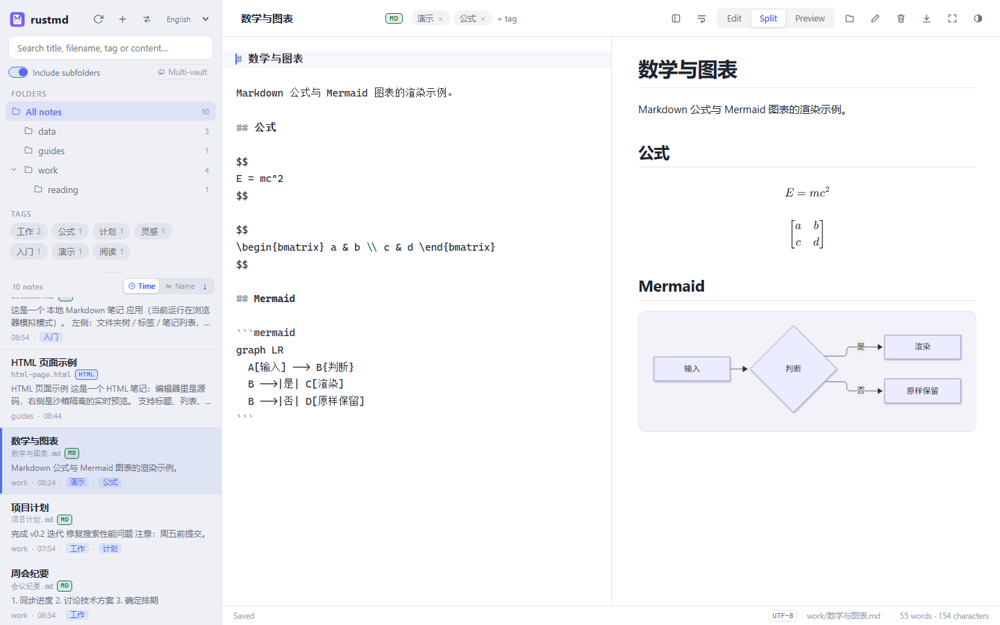

Dark theme and sidebar details:

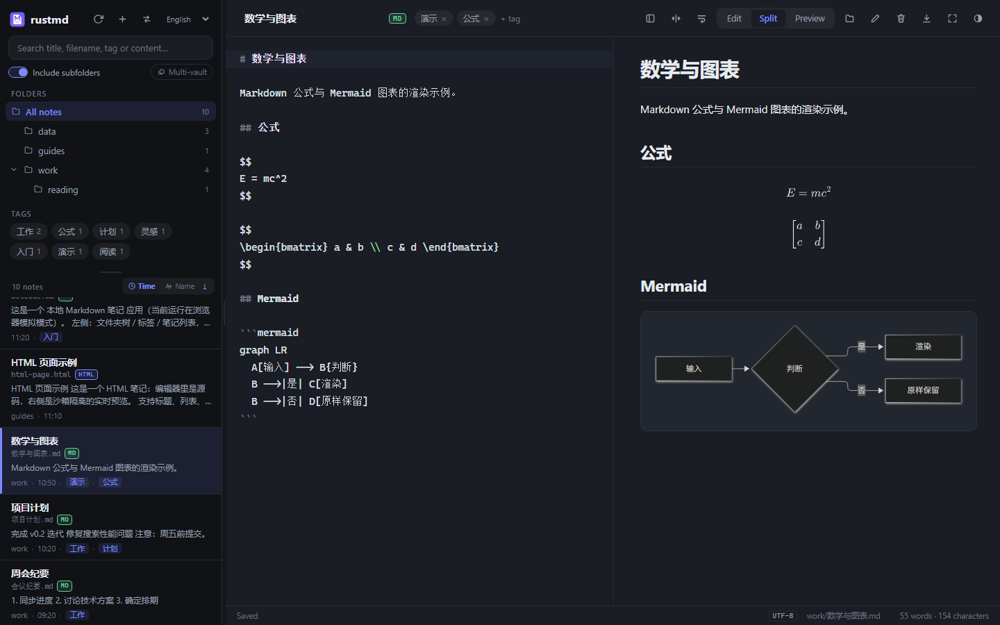

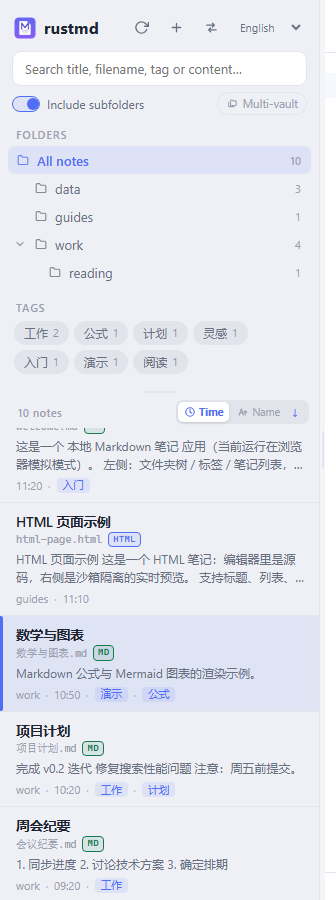

Multi-vault (pinned vaults + the current one, folder tree grouped per vault):

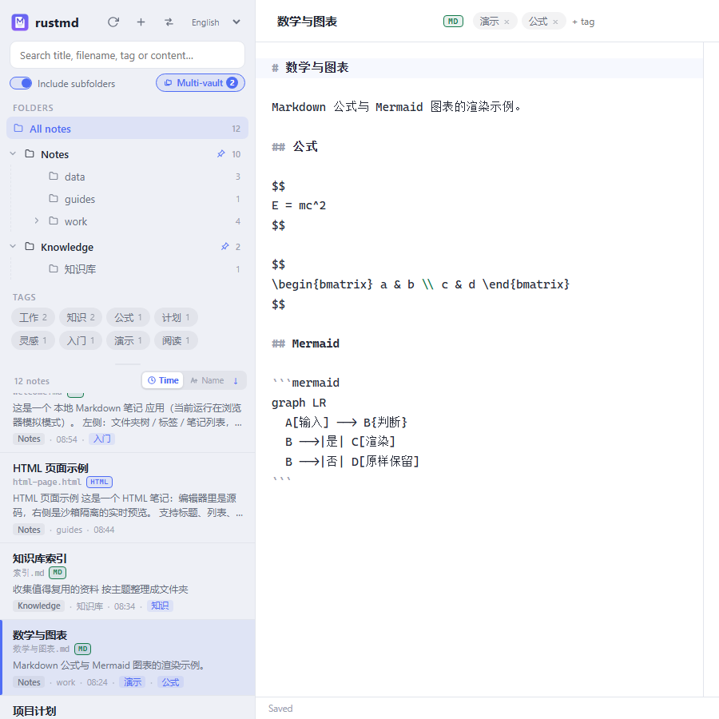

One-click recent-vault switching:

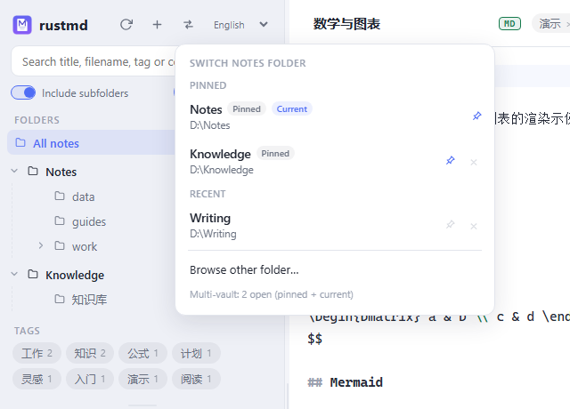

## Rendering by format

HTML notes render through the built-in WebView, including page styles, scripts, local relative assets and charts:

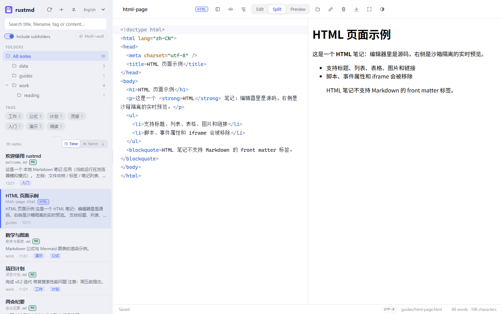

CSV tables: short and numeric columns shrink to content, while long text columns widen up to a 64-character cap; numbers are right-aligned, headers share their column's alignment, and row bands plus per-column ink tints make wide tables scannable:

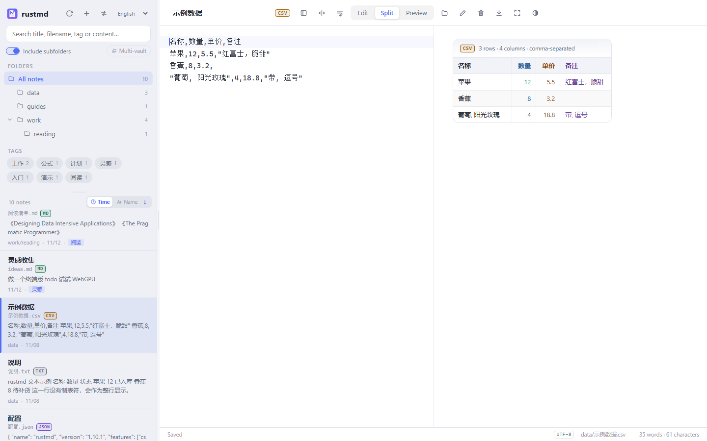

TXT: tab-aligned columns preserve spaces and distinguish tabular rows from full-width prose:

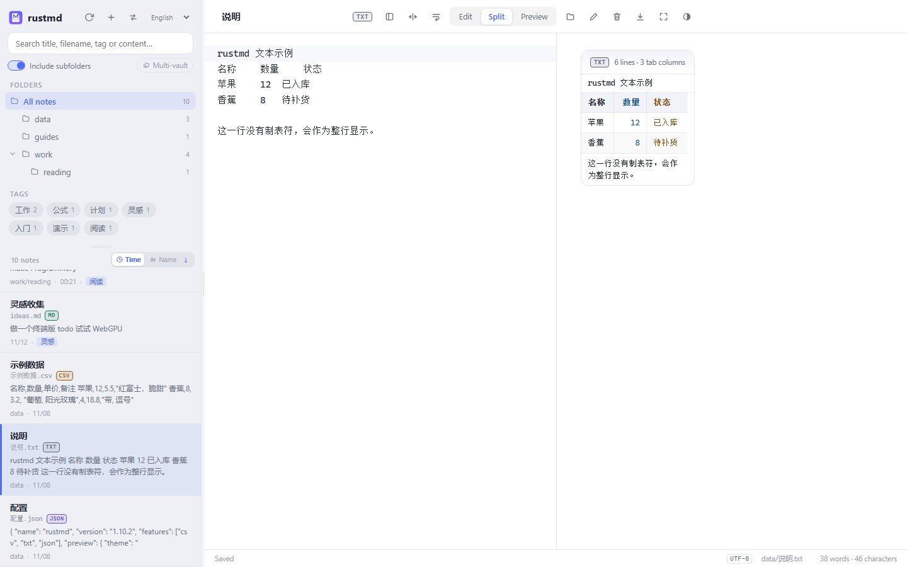

JSON inspector (light / dark): key-value columns, semantic group headers and rails, type pills and type dots, collapsible groups — with the raw JSON kept in the editor:

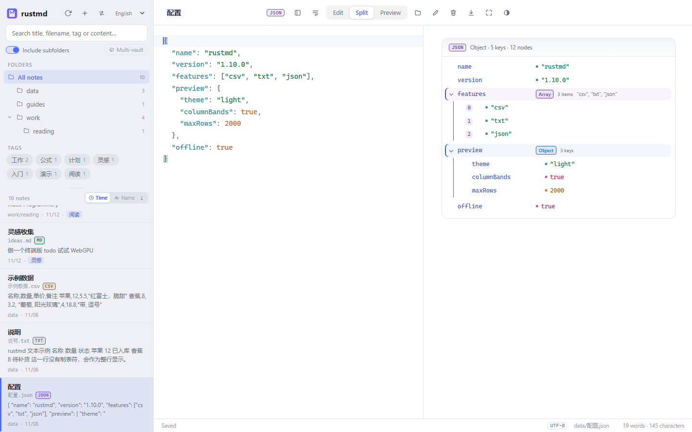

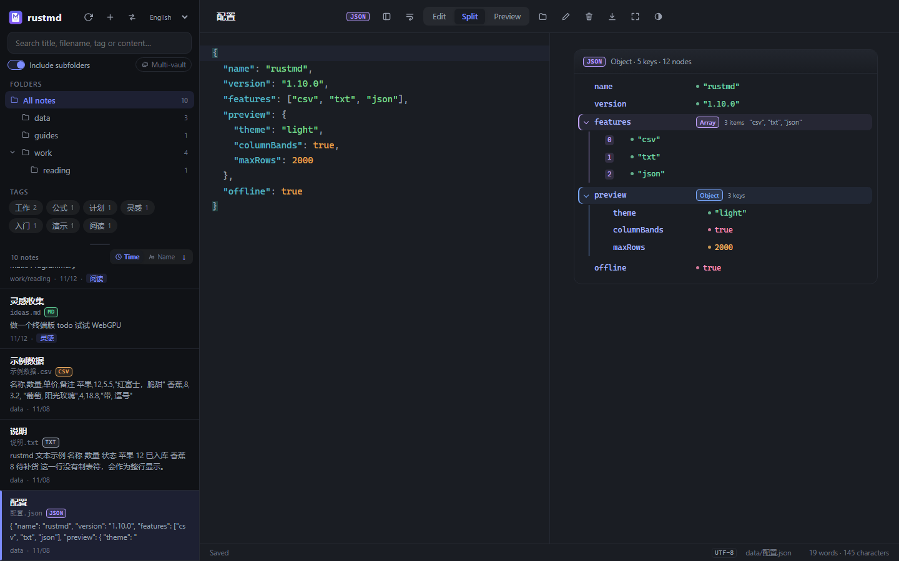

## Multilingual UI

The first launch **follows the system language**: Chinese systems start in Simplified Chinese, everything else starts in English. A language selector is available at the top of the sidebar and on the first-run folder picker; switch between **English / 简体中文** at any time. The choice is stored locally and restored on the next launch. Switching updates the folder tree, note list, sorting, status bar, dialogs, export menu and errors immediately, without reloading notes or losing edits.

Chinese interface example:

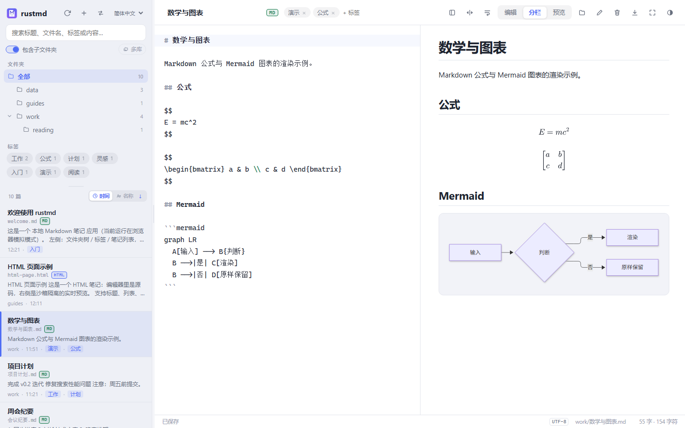

## Features

### Languages

- English and Simplified Chinese interfaces; the first launch follows the system language.
- The language selector lives at the top of the sidebar (and on the first-run folder picker); the choice is persisted locally.
- Switching does not reload notes or lose edits; sorting, status, dialogs and export labels update immediately.

### Navigation

- **Quick vault switching** — the sidebar switch button lists recently opened
  folders (most recent first, up to 20, current one marked) for one-click
  switching. The pin button on each row keeps a vault at the top and exempts
  it from eviction; “Browse other folder…” opens the picker at the current
  folder.
- **Multi-vault** — the **Multi-vault** button below the search box opens every
  pinned vault together with the current one: notes are aggregated in one list,
  and the folder tree groups folders per vault so each vault's subfolders stay
  independently selectable. Vault root sections and every subfolder can be
  collapsed/expanded, and the state is remembered. Click again to return to a
  single vault; the open note's vault is never closed.
- **Manual refresh** — the sidebar refresh button rescans the vault from disk
  (notes, folders, tags, search and counts) without a restart; an open note
  changed on disk is reloaded when clean, and a deleted note is closed safely
  (unsaved edits are kept).
- **Adjustable sidebar inner height** — the folders/tags area is content-sized and the note list takes all remaining height, with a draggable divider between them. Dragging adjusts it live, double-clicking or pressing Enter on the divider restores the content-sized default, and a custom height is remembered.
- **Adjustable widths + one-click reset** — drag the sidebar’s right edge to resize the navigation (320px default, 220px minimum, viewport-aware, up to 680px on 4K), and drag the editor/preview divider to change the split (20%–80%, default 50/50). A topbar **Reset layout widths** button restores 320px + 50/50; both preferences persist locally.
- **Current folder by default** — the note list, search, folder counts and tag cloud cover only notes directly in the selected folder (the vault root on launch); turn on **Include subfolders** below the search box to recurse into the whole subtree, and the choice is remembered.
- **Folder tree** with nested folders, empty folders, collapse/expand.
- **Subfolders collapsed by default**; the expanded state is remembered.
- **Sort by modified time or file name**, with an `↑` / `↓` button to switch ascending/descending; the choice is remembered.
- **Filename on every note card**, plus title, excerpt, folder, time and tags — no more guessing between same-named notes.

### Search

- Searches **title, filename, tags and body**, case-insensitively. Search stays in the current folder by default; enable **Include subfolders** to search the whole subtree.
- For HTML notes the searchable body is the visible page text — tags, scripts and styles are not matched as content. CSV/TXT/JSON notes search their decoded plain text.
- Highlights the matching window and tells you whether the hit was in the title, filename or tags.
- Debounced with a query sequence number so a slow old result cannot overwrite a newer one.

### Editing and preview

- CodeMirror 6 with Markdown, HTML or JSON syntax highlighting, switched by file type (HTML tags, attributes and values get distinct colors, JS/CSS inside `<script>` / `<style>` is highlighted too; CSV/TXT use plain text).
- Editor **auto-wrap / no-wrap** toggle, persisted across restarts — useful for long lines and wide tables.
- Top-right **full screen** button and `F11` shortcut.
- Edit / split / preview (`Ctrl+1` / `Ctrl+2` / `Ctrl+3`); draggable split, persisted.
- 500 ms debounced autosave; external changes are detected by content hash and confirmed before overwrite.
- Save failures keep an “unsaved” state and prompt before switching or closing.

### Markdown rendering

- GFM tables, task lists, strikethrough, autolinks.
- Code highlighting via highlight.js.
- **Mermaid** diagrams (flowchart, sequence, class, gantt, state, pie, ER, …).
- **MathJax 4** inline/display LaTeX, matrices, align, cases — bundled and offline.
- `<details>` / `<summary>` blocks.
- Vault-local images via relative paths, `./`, `file:///`, absolute paths and ``.

### HTML notes

- `.html` / `.htm` files appear alongside Markdown notes in the folder tree, note list, search results and folder counts. Every supported format carries the same prominent badge in the list and the topbar: **`MD` (green) / `HTML` (blue) / `CSV` (amber) / `TXT` (grey) / `JSON` (violet)**.
- Edit the HTML source on the left and see a full-page native render on the right using the app's built-in WebView (WebView2 on Windows, WebKitGTK on Linux, WKWebView on macOS). **No Edge, Chrome or other external browser is required.** The page's `<style>`, `<script>`, local relative CSS/JS/fonts/images and ECharts charts run natively; text stays sharp when scrolling/zooming. `<title>` (or the first `<h1>`) becomes the list title, while the filename stays visible.
- The **New note** button offers **Markdown note**, **HTML page**, **CSV table**, **text file** and **JSON file**. Rename, move, delete, manual refresh and HTML / PNG / PDF export work the same for every format.
- HTML notes have no front matter, so the tag editor is hidden. Saving never injects `---` or `tags:` and preserves the file's BOM and CRLF/LF line endings.
- Preview runs in a **sandboxed iframe** (no `allow-same-origin`; null origin), so note scripts cannot reach the parent DOM or Tauri IPC. Export runs in a hidden, separate Tauri WebView window; all vault commands are label-checked and the hidden window can only return a screenshot or signal print readiness. A sanitized static preview is used only if rendering fails.
- Chart pages usually load CDN scripts, so the first render/export needs network access. **Export HTML** writes the note source as a UTF-8 file and normalizes a legacy `<meta charset="gbk">` (relative CSS/JS/images are not copied with it); PNG still uses a full-page capture from the built-in WebView (tall pages are captured in segments and stitched into one image), while PDF is printed on A4 inside the hidden WebView.
- Markdown and HTML **PDF** is text-based: the system WebView's print pipeline re-lays out the note (WebView2 on Windows, WKWebView on macOS, WebKitGTK on Linux) instead of screenshotting it first, so text search, copy and zoom all work.

### CSV / TXT / JSON previews

- `.csv` / `.txt` / `.json` appear with Markdown and HTML notes in the folder tree, note list, search results and folder counts, with **CSV (amber) / TXT (grey) / JSON (violet)** badges.
- **CSV tables** sniff comma, tab, semicolon or pipe delimiters and support quoted fields, embedded newlines and doubled quotes. The first row is the header. Column widths adapt to content: numeric, date, boolean and short-label columns stay compact while long text columns widen up to a 64-character cap (remaining width is not forcibly distributed). Alignment is inferred from the data (numbers, dates, currency and booleans; headers use the same alignment as their cells), with alternating row bands for horizontal scanning, subtle per-column ink tints for vertical tracking, thin separators and hover highlighting. Wide tables scroll horizontally.
- **TXT tab alignment** splits each line at tab stops into aligned columns while preserving spaces. Lines without tabs span the full row, and leading prose lines are skipped. The first multi-column row becomes a header only when every cell is text and a later row contains a number/date/boolean; a first row with numeric values (such as stock-signal logs) stays a data row instead of being bolded. Smart column widths, alternating row bands and per-column ink tints, a monospace font and right-aligned numeric columns make plain text comfortable to scan.
- **JSON inspector** shows the root type, key/item counts and node count, with collapsible object/array groups (semantic header tints, rails and type pills), key-and-value columns, type/count labels, and a dedicated color plus type dot for strings, numbers, booleans and null. Invalid JSON shows the parse error plus the raw source.
- **Complete data views**: CSV/TXT/JSON are no longer truncated. Data views use the full preview width; a 4K display at 200% scaling (about a 1920×1080 CSS viewport) can show many more columns, while narrow tables still shrink to content instead of forcing a full-width grid. Wide tables get synchronized horizontal scrollbars above and below the table; when there is spare height, tables with 18+ rows distribute it across row heights, while taller tables scroll inside the card with a sticky header.
- **Automatic encoding detection** decodes BOM → UTF-8 → GBK → GB18030 and shows the detected encoding in the status bar. Valid UTF-8 always wins. A rare legacy GBK byte stream can itself be valid UTF-8 (roughly 1,920 common CJK pairs); such ambiguous short files are read as UTF-8, so convert them externally to UTF-8 if they look garbled. Saving keeps the original codec and BOM; a GBK file that gains a four-byte character (e.g. an emoji) is compatibly upgraded to GB18030 and the status bar updates. Repeated UTF-8 BOMs are normalized on read and never accumulate on save.
- A single note is capped at **64 MB**: larger files stay listed by filename with a "too large" hint but their body is not loaded (an untrusted vault cannot freeze the UI with a huge file). Normal CSV/TXT/JSON notes still have no row/column display cap.
- Data notes have no front matter and no tag editor. Rename keeps the extension, and the new-note menu offers all three data formats.

### Export

- **HTML** — Markdown notes export as a standalone page with embedded CSS, the current theme and inlined local images (remote images stay linked); CSV/TXT/JSON exports keep the same smart widths, row-band/column-ink and JSON-inspector styling and use the **full browser width** instead of the 820px reading column: data cards stay content-sized, while wide tables use the viewport and scroll horizontally; HTML notes export as UTF-8 standalone files with any legacy charset declaration normalized. Data HTML exports keep the complete content.
- **PNG** — Markdown usually renders at 3× (~288 DPI); data notes widen the off-screen stage to the table’s natural width and reduce the scale against width, height AND total canvas area (normally 0.25–3×, lower only for extreme geometry) so right-hand columns are never clipped and the WebView canvas limit is not hit; HTML notes adapt between 1× and 3× by page height (3× for short pages; long reports target ~48k device px of height) so very long reports still export in one image.
- **PDF** — Markdown, HTML and narrow data tables are printed by the system WebView (WebView2 on Windows, WKWebView on macOS, WebKitGTK on Linux): the PDF is **vector text** (selectable, searchable, sharp at any zoom) laid out on A4, paginated by the engine's own CSS rules (no lines cut in half, no few-pixel last page) and usually an order of magnitude smaller than the image version. **Printing always uses the light palette**, so a dark-theme PDF is dark text on white on every platform (macOS/Linux print paths do not paint page backgrounds). Windows gets WebView2's title header and page-number footer; macOS/Linux get a centered "current / total" footer stamped by the app, with no browser URL banner. HTML notes keep their own layout, and fixed-width pages are scaled to fit the paper. **Data tables wider than the ~640 CSS px printable area automatically fall back to a landscape raster PDF on a widened stage**, preserving every column but not selectable text; platforms without native printing fall back to block-aware lossless PNG slices.
- For PNG exports, remote images are fetched by the Rust backend and inlined, so exports no longer show blank images. HTML-note PNGs are full-page renders from the built-in WebView, so charts are preserved; very tall pages are captured in segments and stitched. PDFs go through the system print pipeline described above.
- The destination path comes from the native save dialog; the frontend cannot write arbitrary files.

### Security

- Markdown-rendered HTML is sanitized with DOMPurify before `innerHTML`; scripts, event handlers, `javascript:` URLs, `<style>`, `<iframe>` etc. are stripped. HTML-note preview runs in a sandboxed iframe (null origin), and export runs in a hidden WebView window; the preview iframe cannot call app commands, while the export window can only return a screenshot or a print-ready signal.
- MathJax/Mermaid run after sanitization, then a narrow post-pass removes `on*`, dangerous links and external CSS URLs.
- CSP is enabled; external links open in the system browser. HTML preview/export run in isolated WebViews; the export window can only return a screenshot or a print-ready signal.
- `resolve_in_root` contains notes and images inside the vault, rejects `..`, and blocks junction/symlink write escapes; the scanner skips symlinks.
- Remote image fetching rejects loopback/private/link-local/reserved addresses and re-validates redirects.
- Saves use a temp file + atomic rename; `baseHash` conflict detection avoids silent overwrites.
- Text notes are decoded automatically as UTF-8, GBK or GB18030 and saved with the same encoding (GBK upgrades to GB18030 when a four-byte character is added). Ambiguous short GBK byte streams that are also valid UTF-8 are read as UTF-8, a documented residual detection boundary. Unsupported encodings stay visible but show a clear error when opened. CSV/TXT/JSON previews are built exclusively with DOM `textContent`; note markup is never executed.
- HTML-note relative CSS/JS are inlined into the preview/export document, images become data URLs, and fonts use `rmd`; `rmd` only allows classic script/style/font subresources from preview origins, while `fetch`/XHR and document reads still get 403.

## Download

Get the latest from [GitHub Releases](https://github.com/riverzhou/rustmd/releases/latest):

| Platform | Asset | Notes |
| --- | --- | --- |
| Windows | `rustmd-<version>-win-x64-portable.zip` | Portable: unzip and run `rustmd.exe`, no installer |
| Linux | `rustmd_<version>_amd64.deb` / `rustmd_<version>_amd64.AppImage` | Debian/Ubuntu package / portable AppImage |
| macOS | `rustmd-<version>-macos-arm64.dmg` | Apple Silicon (arm64) only; Intel Macs are not supported |

Windows and macOS assets have a `.sha256`; Linux ships `SHA256SUMS-linux.txt`; releases also include a combined `SHA256SUMS.txt` (it requires all release assets in one folder). For a single-platform download, use that platform’s checksum file.

### Windows

1. Unzip and run `rustmd.exe`.
2. Requires the **WebView2 Runtime** (preinstalled on Windows 10/11; install the Evergreen Runtime if missing).
3. The build is signed with a self-signed certificate (public `.cer` included) for integrity only. SmartScreen may still warn about an unknown publisher; verify the source and SHA256, then choose “Run anyway”.
4. The portable build does not write installer entries; delete the folder to remove the app.

### Linux

```bash
sudo apt install ./rustmd_<version>_amd64.deb
# or
chmod +x rustmd_<version>_amd64.AppImage
./rustmd_<version>_amd64.AppImage
```

AppImage needs FUSE; without it use `--appimage-extract-and-run`.

### macOS

The macOS build supports **Apple Silicon (arm64, M-series) only**; Intel Macs are not supported. The `.app` is **ad-hoc signed** (no Apple Developer ID, not notarized). On first launch, allow it in System Settings → Privacy & Security → “Open Anyway”, or run:

```bash
xattr -dr com.apple.quarantine /Applications/rustmd.app
```

Removing the warning completely requires Developer ID + notarization; see [docs/RELEASING.md](docs/RELEASING.md).

### Package managers

Windows (Scoop, self-hosted bucket):

```powershell
scoop bucket add riverzhou https://github.com/riverzhou/scoop-bucket
scoop install rustmd
```

macOS (Homebrew, Apple Silicon):

```bash
brew tap riverzhou/tap
brew install --cask rustmd
```

winget and AUR manifests are ready in [packaging/](packaging/README.md); their one-line
install commands will be added once accepted.

## Quick start

1. Launch the app and choose or type a notes folder. Later launches reopen the last vault, and the sidebar switch button brings back recent folders in one click.
2. Click `＋` to create a note; click folders to filter; click the arrow to expand subfolders. The list shows only that folder's own notes unless **Include subfolders** is on.
3. Rename from the title field; tags, move, delete and export are in the top bar.
4. `Ctrl+B` toggles the sidebar.

Browser-only frontend development (no Rust):

```bash
npm install
npm run dev          # http://127.0.0.1:5173, in-memory mock data
```

## Development

Requirements: Node.js ≥ 20.19, Rust stable with `rustfmt` and `clippy`, and the Tauri system dependencies for your platform (Linux: [docs/TESTING.md](docs/TESTING.md)). Linux source builds, packaging and the no-root sysroot fallback are documented in [LINUX_BUILD.md](LINUX_BUILD.md); after building, `scripts/linux-headless-smoke.sh` smoke-tests the release binary on an isolated Xvfb display.

| Task | Command |
| --- | --- |
| All checks | `npm run check` |
| Tauri dev window | `node scripts/launch-dev.mjs` (`scripts\run-dev.bat` on Windows) |
| Frontend only (mock) | `npm run dev` |
| Release exe, no bundle | `npx tauri build --no-bundle` |
| Frontend unit tests | `npm run test:unit` |
| Rust tests | `npm run test:rust` |
| End-to-end self-test | `npm run selftest` / `npm run selftest:check` |
| Regenerate icons | `npm run icons` |

`scripts/cargo.mjs` probes `$CARGO`, `~/.cargo/bin/cargo` and PATH, so the Windows git-bash shell does not need a manual PATH tweak.

### Automated checks

`npm run check` runs:

1. ESLint 10
2. Node tests for sorting, folder tree, folder scope and scoped tags, recent vaults, CSV/TXT/JSON parsing, delimiter sniffing, type alignment and column-width hints, math protection, code segments and i18n
3. Repository checks (doc links, CSP, plugin permissions, icons, machine-specific paths, untracked `dist`)
4. Version checks (`package.json` / `Cargo.toml` / `tauri.conf.json` plus both lockfile root versions)
5. `cargo fmt --check`, `cargo clippy --all-targets -- -D warnings`, `cargo test`
6. Vite production build

CI: [`.github/workflows/ci.yml`](.github/workflows/ci.yml) runs the quality gate on Ubuntu, compiles on Windows/Linux/macOS, and runs the real-WebView E2E self-test under Xvfb.

### End-to-end self-test

```bash
npm run selftest
```

The dev window renders every example note (Markdown, HTML, CSV, TXT, JSON and a GBK CSV), exports PNG/PDF and HTML, and verifies Markdown residual raw math, multi-line math geometry and image presence (2D NCC); HTML verifies that the built-in WebView iframe becomes ready, local relative CSS/JS/images and inline scripts; data notes verify table/JSON structure, smart header alignment, HTML-text safety, data HTML export and charset; the GBK fixture asserts encoding detection. Artifacts and `report.json` go to the system temp directory under `rustmd-selftest/` (override with `RUSTMD_SELFTEST_OUT`); `npm run selftest:check` requires HTML, CSV, TXT and JSON coverage (the npm script passes `--require-html --require-data`). The app exits 0/1. The code lives in `frontend/src/selftest.js` and is never bundled into release builds.

## Release pipeline

[`.github/workflows/release.yml`](.github/workflows/release.yml) is triggered by a `v*` tag (or manually with an existing tag):

- Windows portable zip + self-signed Authenticode (optional real PFX secrets);
- Linux deb + AppImage + SHA256;
- macOS Apple Silicon (arm64) DMG + ad-hoc signing;
- a combined `SHA256SUMS.txt` and a GitHub Release.

See [docs/RELEASING.md](docs/RELEASING.md) for signing and secrets.

## FAQ

**Is rustmd open source?**
Yes — **GPL-3.0-or-later**. You can use, modify and redistribute it; derivative works must be GPL-compatible. See [LICENSE](LICENSE).

**Does it sync?**
The app does not sync. Notes are a plain folder — use Syncthing, Git, iCloud, OneDrive or Dropbox.

**Can it open my Obsidian vault?**
Yes for plain `.md` / `.html` / `.csv` / `.txt` / `.json` folders, folder hierarchy and Markdown front matter tags. HTML notes are recognized by extension and rendered in the app's built-in WebView; CSV/TXT/JSON get aligned tables, tab columns and a collapsible JSON inspector. Obsidian-specific `[[wikilinks]]`, plugins and canvas are not supported; other front matter fields are preserved on save for Markdown notes.

**Why the Windows/macOS warning?**
Windows uses a self-signed certificate and macOS uses ad-hoc signing. They prove integrity, not a purchased identity. Verify SHA256 and allow the app in the OS prompt.

**Mobile support?**
Desktop only: Windows, macOS (Apple Silicon only) and Linux.

**Where are my notes?**
Only in the folder you opened. No database, account or upload.

**How can I contribute?**
Open an [issue](https://github.com/riverzhou/rustmd/issues) or PR. Run `npm run check` first; for rendering/export bugs, attach the `npm run selftest` report.

## Docs

- [Architecture](docs/ARCHITECTURE.md)
- [Testing & CI](docs/TESTING.md)
- [Release & signing](docs/RELEASING.md)
- [Security](docs/SECURITY.md)
- [Changelog](CHANGELOG.md)
- [Audit report](AUDIT_REPORT.md)
- [Developer & agent guide](AGENTS.md)
- [GitHub project copy & topics](docs/GITHUB_PROJECT_COPY.md)
- [Promotion and launch kit](docs/PROMOTION.md)
- [Package-manager manifests (winget / Scoop / AUR / Homebrew)](packaging/README.md)
- [Contributing guide](CONTRIBUTING.md)

## License

rustmd is licensed under **GPL-3.0-or-later**. See [LICENSE](LICENSE).

## Support

If rustmd is useful to you, a ⭐ helps others discover it; sharing it with someone who wants local Markdown notes is also appreciated.

**Keywords:** local-first Markdown notes, HTML notes, HTML editor, HTML page preview, built-in WebView, HTML reports, CSV tables, TXT files, JSON viewer, GBK encoding, Markdown editor, recent-vault switcher, pinned vaults, multi-vault view, offline notes, knowledge base, Obsidian alternative, Typora alternative, Tauri, Rust, bilingual UI, English/Chinese, Mermaid, LaTeX, PDF export, portable Windows, macOS, Linux.
