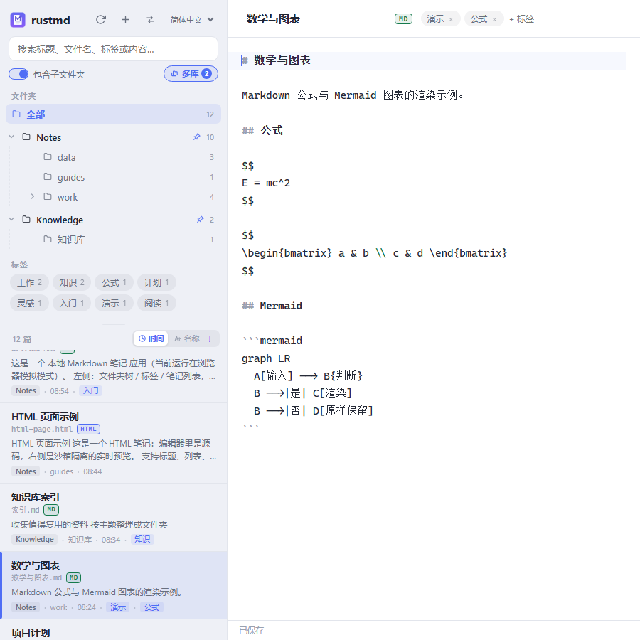
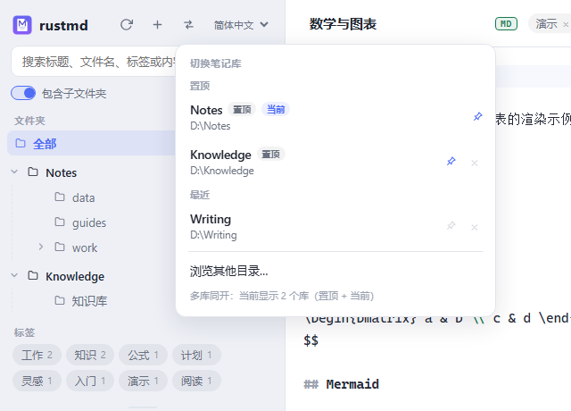
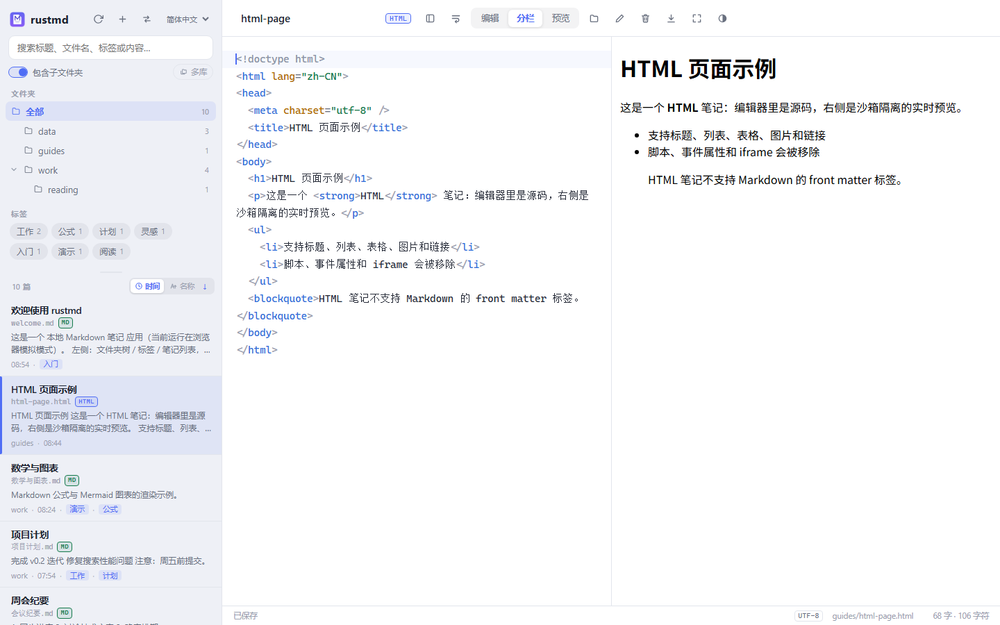
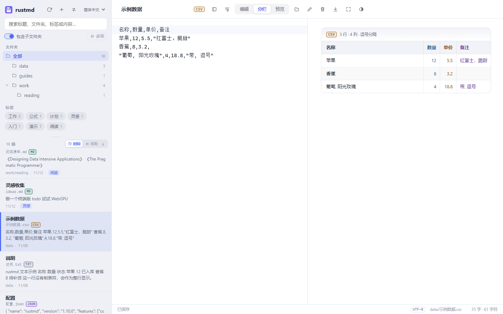
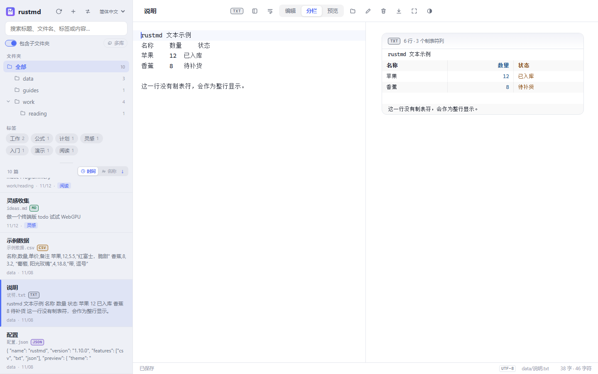
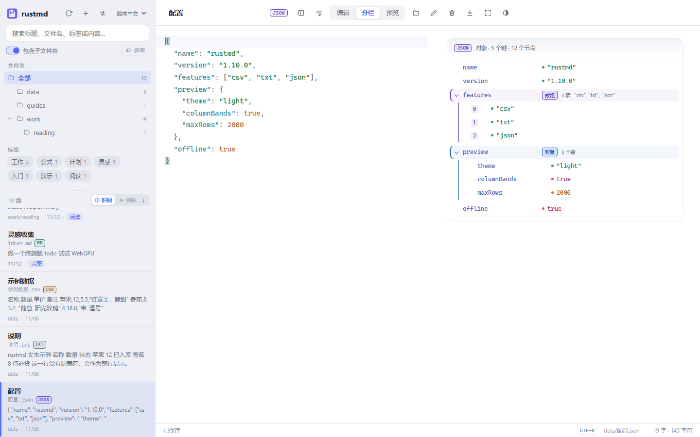
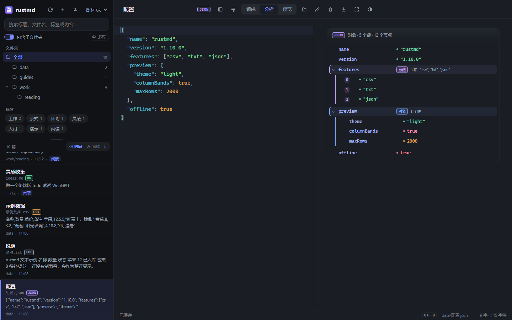

# rustmd

**Local-first Markdown, HTML, CSV, TXT and JSON notes for Windows, macOS (Apple Silicon) and Linux.** Plain `.md` / `.html` / `.csv` / `.txt` / `.json` files, no account, no cloud lock-in — a lightweight desktop notes app built with **Rust + Tauri 2**.

**本地优先、离线可用的 Markdown / HTML / CSV / TXT / JSON 笔记应用（macOS 仅 Apple Silicon）**：文件夹树、文件名卡片、全文搜索、Mermaid 图表、LaTeX 公式、HTML / PNG / PDF 导出；一个笔记库就是一个普通文件夹。

[English](README.en.md) · [简体中文](README.md)

[](https://github.com/riverzhou/rustmd/actions/workflows/ci.yml)
[](https://github.com/riverzhou/rustmd/releases/latest)
[](https://github.com/riverzhou/rustmd/releases)
[](#下载与安装)
[](https://www.rust-lang.org/)
[](https://tauri.app/)
[](LICENSE)
[](https://github.com/riverzhou/rustmd/stargazers)

当前版本 **1.10.0** · GPL-3.0-or-later · [更新日志](CHANGELOG.md) · [下载最新版](https://github.com/riverzhou/rustmd/releases/latest)

## 截图

主界面：文件夹树、当前文件夹范围与多库开关、文件名卡片、排序方向、**MD / HTML / CSV / TXT / JSON 格式徽标**、MathJax 公式与 Mermaid 图表。


深色主题与侧栏细节：


多库同开（置顶库与当前库汇总，文件夹树按库分组）：



最近笔记库一键切换：



## 不同格式的渲染

HTML 笔记由内置 WebView 整页渲染，支持页面自带的样式、脚本、本地相对资源和图表：



CSV 表格：短列和数字列按内容收紧，长文本列占余宽；数字右对齐、表头与内容一致、隔行底色 + 按列文字色：



TXT：制表符分列对齐，保留空格，区分数据行与整行说明文字：



JSON 检查器（浅色 / 深色）：键值分列、分组语义色、类型标签与类型圆点、可折叠；左侧始终保留原始 JSON：





## 多语言界面

首次启动**跟随系统语言**：中文系统显示简体中文，其他系统默认英文。主界面侧栏顶部和首次启动的选择目录页都有语言选择器，可随时切换 **English / 简体中文**；选择会保存在本地，下次启动继续使用。切换后文件树、笔记列表、排序、状态栏、对话框、导出菜单和错误提示会立即更新。

英文界面示例：


## 为什么是 rustmd

如果你想要一个**不把笔记锁进数据库、不强制登录、打开就能写**的 Markdown 工具：

- **纯文件存储**：笔记就是 `.md` / `.html` / `.csv` / `.txt` / `.json`，文件夹就是文件夹；可以用 Git、Syncthing、iCloud、OneDrive 或任何同步工具管理。
- **本地优先**：核心编辑、预览、搜索、导出全部离线可用；拉取远程图片、加载 HTML 报告里的 CDN 脚本等场景才需要网络。
- **轻量跨平台**：Rust + Tauri 2，Windows / macOS / Linux 三端；Windows 提供解压即用的绿色 zip。
- **不只是编辑器**：文件夹树、全文搜索、front matter 标签、**MD / HTML / CSV / TXT / JSON 格式徽标**、MathJax、Mermaid、代码高亮、HTML / PNG / PDF 导出。
- **安全边界认真做**：Markdown HTML 消毒、HTML 笔记在 sandbox iframe / 隐藏 WebView 中隔离渲染、CSP、路径封闭、SSRF 防护、导出走原生保存对话框。
- **适合从 Obsidian / Typora / VS Code 迁移**：直接打开已有 `.md` / `.html` / `.csv` / `.txt` / `.json` 文件夹即可；Markdown front matter 中的 `title:`、`date:` 等字段保存时原样保留。CSV/TXT/JSON 使用表格、制表符与 JSON 检查器视图，并提供 UTF-8 / GBK / GB18030 自动解码。

适合：个人知识库、技术笔记、写作草稿、课程笔记、本地 Markdown 文档库。

关键词：local-first、Markdown 笔记、HTML 笔记、CSV 表格、TXT 文本、JSON 查看器、GBK 编码、Markdown 编辑器、最近笔记库、置顶笔记库、多库同开、多语言界面、English / 中文、离线笔记、Windows 绿色版、Tauri、Rust。

## 功能

### 多语言

- 中文 / English 两套界面；首次启动根据系统语言自动选择。
- 语言选择器位于主界面侧栏顶部（首次启动时也显示在目录选择页），选择持久化到本地。
- 切换后不重载笔记、不丢失编辑内容；排序、状态、对话框和导出文案同步更新。

### 文件导航

- **快速切换笔记库**：侧栏切换按钮直接列出最近打开的目录（按最近使用排序，最多 20 个，
  当前目录带标记）。每个目录右侧的图钉可“钉死/置顶”：置顶库固定在列表最上方，
  且永远不会被淘汰。点一下即可切换；需要新目录时“浏览其他目录…”会从当前目录开始。
- **多库同开**：搜索框下方的“多库”按钮会同时打开所有置顶库（加上当前库），
  笔记汇总在同一个列表中；文件夹树按库分组，各库的子目录可以独立选择。
  库根节点和各级子目录都可以折叠/展开，折叠状态会记住。
  再次点击按钮恢复单库视图，当前打开笔记所在的库不会被关闭。
- **手动刷新**：侧栏顶部的刷新按钮从磁盘重新扫描整个笔记库（笔记、文件夹、标签、
  搜索与计数），无需重启；打开中的笔记被外部修改且没有未保存内容时会自动重新
  载入，被删除时安全关闭或保留未保存内容。
- **可调侧栏比例**：侧栏默认 320px，文件夹/标签区按内容自适应，下方笔记列表占满剩余高度；两者之间有一条可拖动分隔条，拖动可随时调整，双击/Enter 恢复默认，高度会记住。
- **默认只看当前文件夹**：笔记列表、搜索、文件夹计数和标签云默认只覆盖当前文件夹（启动时是笔记库根目录）的直属笔记，不进入子文件夹；打开搜索框下方的“包含子文件夹”开关后才递归整个子树，开关状态会记住。
- **文件夹树**：支持嵌套文件夹、空文件夹、折叠/展开。
- **子文件夹默认折叠**：只显示顶层文件夹，点击箭头逐层展开；展开状态会记住。
- **两种排序 + 方向**：可按最后修改时间或文件名排序，通过 `↑` / `↓` 按钮切换升序/降序；选择持久化。
- **文件名卡片**：每张笔记卡片显示标题、**文件名**、摘要、所在文件夹、修改时间与标签，同名笔记也容易区分。

### 搜索

- 同时搜索**标题、文件名、标签、正文**；大小写不敏感。搜索默认只覆盖当前文件夹的直属笔记，打开“包含子文件夹”后递归整个子树。HTML 笔记搜索的是页面可见文本，不会把标签、脚本或样式当作正文命中；CSV/TXT/JSON 搜索解码后的纯文本。
- 结果列表高亮命中片段，并显示是标题、文件名还是标签命中。
- 输入防抖 + 请求序列号，快速输入时旧结果不会覆盖新结果。

### 编辑与预览

- CodeMirror 6 编辑器，按文件类型切换 Markdown / HTML / JSON 语法高亮（HTML 标签、属性、属性值有独立配色；`<script>` / `<style>` 内的 JS/CSS 也按关键字、字符串、函数、变量、注释等分别着色；CSV/TXT 使用纯文本模式）。
- 编辑器支持 **自动折行 / 不折行** 切换，状态会记住；长行/宽表格可一键切换。
- 右上角 **全屏** 按钮与 `F11` 快捷键可切换全屏，退出后回到窗口模式。
- 编辑 / 分栏 / 预览三种视图（`Ctrl+1` / `Ctrl+2` / `Ctrl+3`），分栏可拖动，比例持久化。
- 500ms 防抖自动保存；外部修改通过内容 hash 检测，覆盖前会询问。
- 保存后更新文件树与标签计数；保存失败保留“未保存”状态，切换或关闭前提示。

### Markdown 渲染

- GFM：表格、任务列表、删除线、自动链接。
- 代码高亮（highlight.js）。
- **Mermaid** 图表：流程图、时序图、类图、甘特图、状态图、饼图、ER 图等。
- **MathJax 4**：行内 / 块级 LaTeX、矩阵、align、cases；MathJax 与扩展都打包在应用内，离线可用。
- `<details>` / `<summary>` 折叠块。
- 笔记库本地图片：相对路径、`./`、`file:///`、绝对路径、`` 均可显示。

### HTML 笔记

- 笔记库中的 `.html` / `.htm` 文件会和 Markdown 一起出现在文件夹树、笔记列表、搜索结果和文件夹计数中。**所有支持的格式在列表和顶栏都有一致醒目的格式徽标：`MD`（绿）/ `HTML`（蓝）/ `CSV`（橙）/ `TXT`（灰）/ `JSON`（紫）**，一眼即可区分。
- 左侧编辑 HTML 源码，右侧用应用内置 WebView（Windows 的 WebView2 / Linux 的 WebKitGTK / macOS 的 WKWebView）直接整页渲染；无需安装 Edge、Chrome 或任何外部浏览器。页面自带的 `<style>`、`<script>`、本地相对 CSS/JS/字体/图片、ECharts 图表都会执行，滚动/缩放为原生清晰文本。`<title>` 或第一个 `<h1>` 作为列表标题，文件名仍可见。
- 顶部新建按钮提供 **Markdown 笔记 / HTML 页面 / CSV 表格 / 纯文本文件 / JSON 文件**；重命名、移动、删除、手动刷新和 HTML / PNG / PDF 导出与 Markdown 笔记一致。
- HTML 笔记没有 front matter，因此不显示标签编辑器；保存时不会插入 `---` 或 `tags:`，并保留文件原有的 BOM 与 CRLF/LF 换行风格。
- 预览在 **sandbox iframe** 中运行（无 `allow-same-origin`，origin 为 null），拿不到父页面 DOM/Tauri IPC；导出在隐藏的独立 Tauri WebView 窗口中执行，所有笔记/保险库命令按窗口 label 校验，隐藏窗口只能回传截图或通知打印就绪。渲染失败时才回退为 DOMPurify 消毒后的静态预览。
- 图表页面通常依赖 CDN 脚本，首次渲染/导出需要联网；HTML 笔记的 **导出 HTML** 输出 UTF-8 独立文件，并把遗留的 `<meta charset="gbk">` 规范化为 UTF-8；PNG 仍由内置 WebView 整页截图（超长页面分段拼接），PDF 则在隐藏 WebView 里按 A4 打印。
- Markdown 和 HTML 笔记的 **PDF** 是文字版：由系统 WebView 的打印管线重新排版（Windows：WebView2；macOS：WKWebView；Linux：WebKitGTK），不再把整页先截成图片；因此搜索、复制文字和放大查看都正常。

### CSV / TXT / JSON 数据预览

- `.csv` / `.txt` / `.json` 与 Markdown、HTML 一起出现在文件夹树、笔记列表、搜索结果和文件夹计数中，并带 **CSV（橙）/ TXT（灰）/ JSON（紫）** 徽标。
- **CSV 表格**：识别逗号 / 制表符 / 分号 / 竖线分隔符，支持带引号字段、字段内换行和双引号转义；首行作为表头。列宽按内容智能分配：数字、日期、布尔和短文本列收紧，长文本列占更多宽度；对齐算法识别数字、日期、货币和布尔值，表头与数据格使用同一对齐方式。外观上用隔行底色负责横向扫读、按列文字色负责纵向定位，再加细分隔线和悬停高亮；列多时横向滚动。
- **TXT 制表符对齐**：按制表符拆成对齐的列，保留行内空格；无制表符的行按整行显示，自动跳过前置说明行、取第一行多列文本作为表头参与对齐判断。等宽字体、数字列右对齐，配合智能列宽、隔行底色和按列文字色让纯文本也容易阅读。
- **JSON 检查器**：展示根类型、键/项数量、节点数，可折叠的对象/数组分组，键与值分列对齐，对象/数组分组带语义色浅底、侧边轨和同色系类型标签，字符串/数字/布尔/null 各有独立色彩与类型圆点；非法 JSON 显示错误与原文，便于继续编辑。
- **显示上限**：为避免超大文件卡死，预览（以及由预览生成的导出）最多显示 CSV 2000 行 / 100 列、TXT 5000 行 / 80 列、JSON 6000 个节点；超出时会显示明确的截断提示，HTML/PNG/PDF 导出包含当前可见内容。
- **自动编码识别**：读取时按 BOM → UTF-8 → GBK → GB18030 自动解码，状态栏显示当前编码；合法的 UTF-8 始终优先。GBK 字节序列极少数情况下也会构成合法 UTF-8（约 1920 个常用汉字的组合），这类有歧义的短文件会按 UTF-8 读取；如遇乱码，请先在外部转换为 UTF-8。保存时沿用原编码和 BOM；如果向 GBK 文件写入 GB18030 可表示的四字节字符（例如 emoji），会兼容升级为 GB18030，并在保存后同步状态栏。重复的 UTF-8 BOM 会在读取时归一化，不会在连续保存中累积。
- 数据笔记没有 front matter，因此不显示标签编辑器；重命名保留扩展名，新建菜单也支持这三种格式。

### 导出

- **HTML**：Markdown 笔记导出为内嵌样式、跟随当前主题、本地图片内联的独立页面；CSV/TXT/JSON 导出包含同样的智能列宽、隔行底色/列文字色和 JSON 检查器样式；HTML 笔记输出 UTF-8 独立文件并规范化遗留 charset。数据笔记若触发显示上限，导出内容同样带截断提示。
- **PNG**：Markdown 与 CSV/TXT/JSON 使用 3× 渲染（约 288 DPI，长内容自适应）；HTML 笔记按页面高度在 1–3× 间自适应（短页面 3×，超长报告目标高度约 48k 设备像素），整页保持。
- **PDF**：Markdown、CSV、TXT、JSON 与 HTML 笔记都走系统 WebView 的打印管线（Windows：WebView2；macOS：WKWebView；Linux：WebKitGTK）——输出的是**矢量文字**，可选中、可搜索、任意放大都清晰，A4 排版，由引擎按 CSS 规则分页（不会把一行文字切成两半，也不会出现只有几像素的尾页），文件通常比图片版小一个数量级。Windows 由 WebView2 绘制页眉标题 + 页脚页码；macOS/Linux 打印后由应用补一个居中的「当前页 / 总页数」页脚，不添加浏览器地址栏信息。HTML 笔记保留自己的排版风格，固定宽度页面会整体缩放以适配纸张。某个平台或环境不支持原生打印时，会自动回退为按块边界分页的无损 PNG 切片。
- PNG 导出时，远程图片经 Rust 后端拉取并内联，不再出现空白图；HTML 笔记的 PNG 由内置 WebView 整页渲染（超长报告按高度自适应分段截取并拼接为单图），PDF 则走上面的系统打印管线。
- 导出目标路径由系统保存对话框选择，前端不能任意写文件。

### 安全

- Markdown 渲染出的 HTML 在进入 webview 前经 DOMPurify 消毒；脚本、事件属性、`javascript:` URL、`<style>`、`<iframe>` 等被剥离。HTML 笔记预览在 sandbox iframe（null origin）中运行，导出在隐藏 WebView 中运行；预览 iframe 无法调用应用命令，导出窗口只能回传截图或打印就绪信号。
- MathJax / Mermaid 在消毒之后生成 DOM，再做一次窄范围清理（`on*`、危险链接、外部 CSS URL）。
- Tauri CSP 默认启用；外部链接交给系统浏览器打开。HTML 预览/导出在隔离的 WebView 中运行，导出窗口只能回传截图或打印就绪信号。
- `resolve_in_root` 对笔记与图片做路径封闭，阻止 `..`、junction/symlink 写逃逸；扫描时跳过符号链接。
- 远程图片抓取拒绝 loopback / 私有网段 / 链路本地 / 保留地址，并校验每次重定向。
- 保存使用临时文件 + 原子替换；`baseHash` 冲突检测避免静默覆盖外部修改。
- 文本笔记自动识别 UTF-8 / GBK / GB18030；保存沿用原编码（GBK 遇到四字节字符时升级为 GB18030）。有歧义的短 GBK 字节会按合法 UTF-8 解释，这是编码检测的残余边界；无法识别的编码不会被静默隐藏，打开时显示明确错误。CSV/TXT/JSON 预览全部使用 DOM `textContent` 构建，不执行笔记内容中的 HTML。
- HTML 笔记的相对 CSS/JS 会内联进预览/导出文档，图片内联为 data URL，字体走 `rmd`；`rmd` 只对无法内联的 classic script/style/font 子资源放行预览源，`fetch`/XHR 与文档读取仍返回 403。

## 下载与安装

从 [GitHub Releases](https://github.com/riverzhou/rustmd/releases/latest) 下载：

| 平台 | 产物 | 说明 |
| --- | --- | --- |
| Windows | `rustmd-<version>-win-x64-portable.zip` | **绿色版**：解压后直接运行 `rustmd.exe`，不写注册表 |
| Linux | `rustmd_<version>_amd64.deb` / `rustmd_<version>_amd64.AppImage` | Debian/Ubuntu 安装包 / 便携 AppImage |
| macOS | `rustmd-<version>-macos-arm64.dmg` | 仅 Apple Silicon（arm64）；不支持 Intel Mac |

Windows / macOS 资产旁提供 `.sha256`；Linux 提供 `SHA256SUMS-linux.txt`；Release 里还有合并的 `SHA256SUMS.txt`（需要全部资产在同一目录才能校验）。只下载单平台时请用对应平台的校验文件。

### Windows

1. 解压 zip，运行 `rustmd.exe`。
2. 需要 **WebView2 Runtime**；Windows 10/11 通常已自带，缺失时安装 Evergreen Runtime。
3. 发布包使用自签名证书做完整性签名（压缩包内附 `rustmd-selfsigned.cer`）；它**不能消除** SmartScreen 的“未知发布者”提示。请核对来源与 SHA256 后选择“仍要运行”。
4. 绿色版不写安装信息；删除文件夹即可移除程序。

### Linux

```bash
# Debian / Ubuntu
sudo apt install ./rustmd_<version>_amd64.deb

# AppImage
chmod +x rustmd_<version>_amd64.AppImage
./rustmd_<version>_amd64.AppImage
```

AppImage 需要 FUSE；没有 FUSE 时使用 `--appimage-extract-and-run`。

### macOS

macOS 包仅支持 **Apple Silicon（arm64，M 系列）**，不支持 Intel Mac。DMG 内的 `.app` 使用 **ad-hoc 签名**（没有 Apple Developer ID，未公证）。首次打开会被 Gatekeeper 拦截：

- 系统设置 → 隐私与安全性 → “仍要打开”；或
- `xattr -dr com.apple.quarantine /Applications/rustmd.app`

彻底消除提示需要 Developer ID + 公证（见 [docs/RELEASING.md](docs/RELEASING.md)）。

### 校验下载

```bash
# 合并文件需要先把全部 Release 资产下载到同一目录：
sha256sum -c SHA256SUMS.txt
# 只下载单平台时用同名 .sha256（Windows/macOS）或 SHA256SUMS-linux.txt（Linux）
```

## 快速开始

1. 启动应用，选择或输入笔记目录；也可以直接打开已有的 Markdown 文件夹。再次启动会打开上次的笔记库，侧栏切换按钮可一键回到最近目录。
2. 左侧 `＋` 新建笔记；点击文件夹筛选，点击箭头展开子文件夹。列表默认只看该层笔记，点击搜索框下方的“包含子文件夹”可包含整个子树。
3. 标题输入框可重命名文件；标签、移动、删除、导出在顶栏。
4. 顶栏按钮或 `Ctrl+B` 隐藏/显示侧栏。

常用快捷键：

| 快捷键 | 功能 |
| --- | --- |
| `Ctrl+1` / `Ctrl+2` / `Ctrl+3` | 编辑 / 分栏 / 预览 |
| `Ctrl+B` | 隐藏 / 显示侧栏 |
| `F11` | 全屏 / 退出全屏 |
| `Enter`（标题框） | 提交重命名 |
| `Enter` 或 `,`（标签框） | 添加标签 |

浏览器前端调试（不需要 Rust）：

```bash
npm install
npm run dev          # http://127.0.0.1:5173，使用内存 mock 数据
```

## 开发

前置：Node.js ≥ 20.19、Rust stable（含 `rustfmt`、`clippy`）以及对应平台的 Tauri 系统依赖（Linux 见 [docs/TESTING.md](docs/TESTING.md)）。

Linux 从源码构建、依赖安装、绿色版打包与无 root sysroot 兜底见 [LINUX_BUILD.md](LINUX_BUILD.md)；构建后可运行 `scripts/linux-headless-smoke.sh` 在隔离 Xvfb 中冒烟测试 release 二进制。

| 任务 | 命令 |
| --- | --- |
| 全部检查 | `npm run check` |
| Tauri 开发窗口 | `node scripts/launch-dev.mjs`（Windows 可用 `scripts\run-dev.bat`） |
| 仅前端（mock） | `npm run dev` |
| 发布 exe（不打包安装器） | `npx tauri build --no-bundle`（Windows 可用 `scripts\run-build.bat`） |
| 前端纯函数单测 | `npm run test:unit` |
| Rust 单测 | `npm run test:rust` |
| 端到端自测 | `npm run selftest` / `npm run selftest:check` |
| 重新生成图标 | `npm run icons` |

`scripts/cargo.mjs` 会依次尝试 `$CARGO`、`~/.cargo/bin/cargo`、PATH 中的 `cargo`；Windows git-bash 不需要手动补 PATH。

### 自动化检查

`npm run check` 依次执行：

1. ESLint 10
2. Node 前端单测（排序、文件夹树、当前目录/子树范围、范围标签计数、最近笔记库、CSV/TXT/JSON 解析与对齐、数学保护、代码段、多语言）
3. 仓库检查（文档链接、CSP、插件权限、图标、机器相关路径、`dist` 未跟踪）
4. 版本检查（`package.json` / `Cargo.toml` / `tauri.conf.json` 及两个 lockfile 的根包版本一致）
5. `cargo fmt --check`、`cargo clippy --all-targets -- -D warnings`、`cargo test`
6. Vite 生产构建

CI：[`.github/workflows/ci.yml`](.github/workflows/ci.yml) 在 Ubuntu 跑完整质量门禁，在 Windows / Linux / macOS 三端编译，并用 Xvfb + 真实 WebKitGTK 跑端到端自测。

### 端到端自测

```bash
npm run selftest
```

dev 窗口会渲染 `examples/` 下全部示例笔记（含 Markdown、HTML、CSV、TXT、JSON 与 GBK CSV），逐一导出 PNG/PDF 和 HTML。Markdown 校验残留未渲染公式、多行公式几何、远程图片与笔记库本地图片是否真的出现在导出的 PNG 中（2D NCC）；HTML 校验内置 WebView 的 iframe 是否 ready、本地相对 CSS/JS/图片与内联脚本；数据笔记校验表格/JSON 检查器结构、智能表头对齐、HTML 文本不注入 DOM、数据 HTML 导出及 charset；GBK 示例断言编码识别。产物与 `report.json` 写入系统临时目录的 `rustmd-selftest/`，可用 `RUSTMD_SELFTEST_OUT` 覆盖；`npm run selftest:check` 默认要求 HTML、CSV、TXT、JSON 全覆盖（脚本已带 `--require-html --require-data`）。代码位于 `frontend/src/selftest.js`，release 构建不包含它。

## 目录结构

```
├── src/main.rs               # 全部 Rust：命令、路径安全、front matter、rmd 协议、单测
├── frontend/
│   ├── index.html
│   ├── public/               # 图标、highlight.js 主题
│   └── src/                  # main.js / api.js / editor.js / preview.js / export.js
│                             #   notelist.js / vaultlist.js / markdown.js / imgutil.js / selftest.js / style.css
├── scripts/                  # 开发服务器、图标、检查、自测、签名与 Windows 绿色包
├── examples/                 # 示例笔记库（含 CSV/TXT/JSON/GBK），同时是自测夹具
├── capabilities/             # Tauri 权限
├── icons/                    # 应用图标（npm run icons 生成，含 .icns）
├── docs/                     # 架构、测试、发布、安全文档
├── .github/workflows/        # CI 与三端发布
├── tauri.conf.json
├── Cargo.toml
└── package.json
```

## 三端发布

发布由 [`.github/workflows/release.yml`](.github/workflows/release.yml) 完成：

- 推 `v*` tag（或手动填 tag）触发；
- Windows：绿色 zip + 自签名 Authenticode（可选真实 PFX secrets）；
- Linux：deb + AppImage + SHA256；
- macOS：Apple Silicon（arm64）DMG + ad-hoc 签名；
- 所有资产汇总 `SHA256SUMS.txt` 并创建 GitHub Release。

签名策略与 secrets 配置见 [docs/RELEASING.md](docs/RELEASING.md)。

## 常见问题

**Q：rustmd 开源吗？**
是，采用 **GPL-3.0-or-later**。你可以自由使用、修改和分发；衍生作品需按 GPL 兼容方式开源。详见 [LICENSE](LICENSE)。

**Q：支持同步吗？**
应用本身不做云同步。笔记是普通文件夹，交给 Syncthing、Git、iCloud、OneDrive、Dropbox 等即可。

**Q：能打开 Obsidian 的 vault 吗？**
可以打开普通 `.md` / `.html` / `.csv` / `.txt` / `.json` 文件夹，文件夹层级和 Markdown front matter 标签可用。HTML 笔记按文件扩展名识别，编辑源码并由应用内置 WebView 渲染整页预览。Obsidian 特有的 `[[wikilink]]`、插件、canvas 等不在支持范围内；保存 Markdown 时其它 front matter 字段会保留。

**Q：为什么 Windows 会提示未知发布者 / macOS 会提示无法验证？**
Windows 使用自签名证书、macOS 使用 ad-hoc 签名，只保证完整性，没有购买商业代码签名/公证。校验 SHA256 后按系统提示放行即可。

**Q：支持移动端吗？**
当前只提供 Windows / macOS / Linux 桌面端。macOS 构建仅支持 Apple Silicon（arm64），不支持 Intel Mac。

**Q：笔记存在哪里？**
只存在你打开的文件夹里；应用没有数据库、没有账号、不会上传笔记。

**Q：如何反馈问题或贡献代码？**
欢迎提 [Issue](https://github.com/riverzhou/rustmd/issues) 或 PR。提交前请跑 `npm run check`；如果是渲染/导出问题，附上 `npm run selftest` 的 report 会很有帮助。

## 文档

- [Architecture / 架构](docs/ARCHITECTURE.md)
- [Testing & CI / 测试](docs/TESTING.md)
- [Release & Signing / 发布签名](docs/RELEASING.md)
- [Security / 安全](docs/SECURITY.md)
- [Changelog / 更新日志](CHANGELOG.md)
- [Audit Report / 审计报告](AUDIT_REPORT.md)
- [Developer & Agent Guide / 开发指南](AGENTS.md)
- [GitHub 项目文案与 topics](docs/GITHUB_PROJECT_COPY.md)

## License

rustmd 以 **GPL-3.0-or-later** 发布。完整条款见 [LICENSE](LICENSE)。

## 支持项目

如果 rustmd 对你有帮助，给一个 ⭐ 是最直接的鼓励；也欢迎分享给需要本地 Markdown 笔记的朋友。

**关键词**：Markdown 笔记、HTML 笔记、CSV 表格、TXT 文本、JSON 查看器、GBK 编码、本地笔记、离线笔记、Markdown 编辑器、最近笔记库切换、置顶笔记库、多库同开、知识库、Obsidian 替代、Typora 替代、Tauri、Rust、Mermaid 图表、LaTeX 公式、PDF 导出、Windows 绿色版、macOS、Linux。
